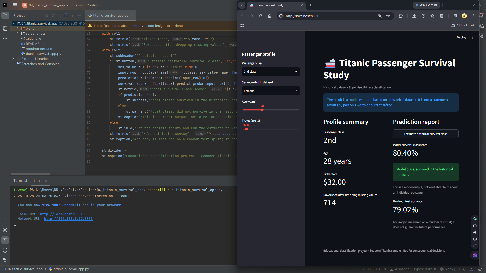

# Titanic Passenger Survival Prediction App

**Junior Machine Learning Project**  
**Author:** Moe Htet Ar Kar (Phoe Cho)

A supervised binary-classification web app that estimates the historical survival outcome associated with a passenger profile using Logistic Regression.

> **Scope:** A learning and portfolio application built with a small, understandable Python script. It is not a production or safety-critical system.

## Dashboard Design



## What the project demonstrates

- Building an interactive user interface with Streamlit.
- Preparing input features in a consistent order and passing them to a scikit-learn model.
- Training and caching a model to avoid retraining on every Streamlit rerun.
- Presenting model output and interpreting it with appropriate caveats.
- Organizing a small Python project with isolated dependencies and Git hygiene.

## Model and data

**Model / workflow:** Train/test split (80/20), StandardScaler + LogisticRegression pipeline, accuracy on the held-out test set.

**Training data:** Seaborn Titanic dataset; rows with missing values in the selected target and four features are removed. Selected features: passenger class, encoded sex, age, and fare.

## Output design

A clean blue passenger-profile dashboard with passenger class, sex, age, and fare inputs; an estimated survival-class probability; and a held-out baseline accuracy metric.

The live application is designed to show the entered features, the model output, and an explanation of what the result means. A prediction is only as reliable as its data, labels, features, and evaluation method.

## Technology stack

- Python 3.11
- Streamlit
- pandas / NumPy where used by this project
- scikit-learn
- TensorFlow/Keras where required by this project

## Run locally

### 1. Prerequisite

Install **64-bit Python 3.11**. Confirm it is available in your terminal:

```bash
python --version
```

On Windows, if the `python` command points to another interpreter, use `py -3.11` in place of `python` when creating the environment.

### 2. Create and activate a virtual environment

**Windows PowerShell**

```powershell
py -3.11 -m venv .venv
.\.venv\Scripts\Activate.ps1
python -m pip install --upgrade pip
```

**macOS / Linux**

```bash
python3.11 -m venv .venv
source .venv/bin/activate
python -m pip install --upgrade pip
```

### 3. Install dependencies

```bash
python -m pip install -r requirements.txt
```

**Data note:** Seaborn downloads its Titanic dataset on first use. An internet connection may be required the first time the app starts.

### 4. Start the application

Run this command from the same folder as `requirements.txt`:

```bash
streamlit run titanic_survival_app.py
```

Streamlit prints a local URL in the terminal (normally `http://localhost:8501`). Open that address in your browser. To stop the app, press `Ctrl+C` in the terminal.

## Project folder structure

```text
04_titanic_survival_app/
├── titanic_survival_app.py
├── requirements.txt
├── README.md
├── .gitignore
└── screenshots/
    └── output.png
```
## Current limitations

This is a historical educational exercise, not a model for predicting an individual’s real-world safety. The dataset is accessed through Seaborn and may require an internet connection the first time it is fetched. The selected features omit many contextual factors and the model’s accuracy is dataset-specific.

## Future improvements

1. Replace generated or toy data with a documented, appropriate dataset and record its source and license.
2. Add a repeatable evaluation process, appropriate metrics, baseline comparisons, and model-validation tests.
3. Save a trained model only after validating it, then separate training from app inference if the project grows.
4. Add input validation, clear error messages, and a simple automated test suite.
5. Capture real screenshots and document a reproducible test scenario.

## Portfolio summary

This project demonstrates a junior-level end-to-end workflow: a Python ML model, a simple interactive front end, input handling, result presentation, dependency isolation, and honest documentation of limitations. It should be presented as a learning prototype rather than a production-grade system.

## References

- [Seaborn `load_dataset` documentation](https://seaborn.pydata.org/generated/seaborn.load_dataset.html)
- [scikit-learn Logistic Regression documentation](https://scikit-learn.org/stable/modules/generated/sklearn.linear_model.LogisticRegression.html)
